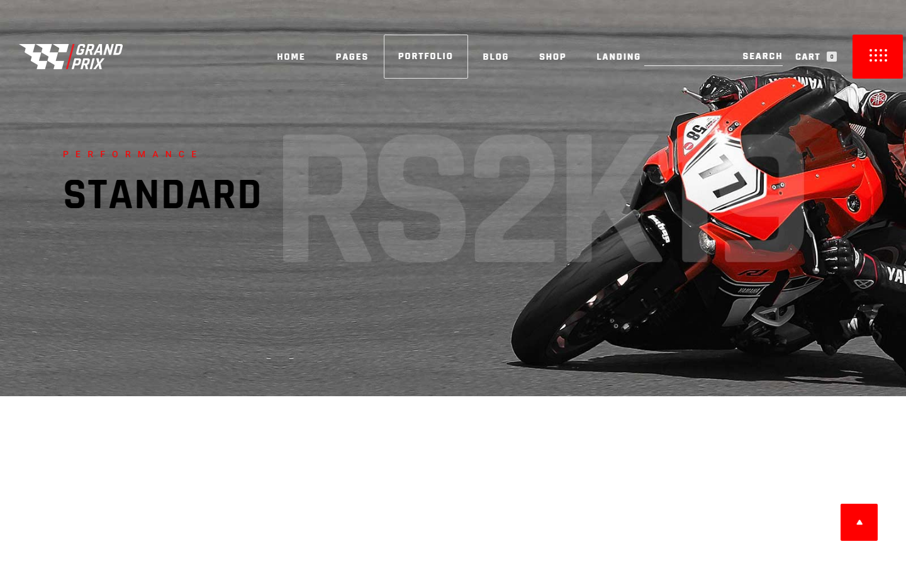
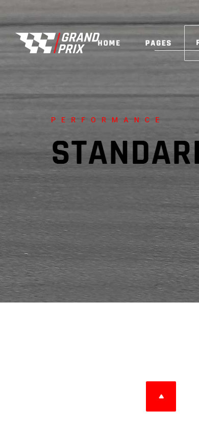

# Grand Prix — Motorcycle Store

**A motorcycle shop landing page with a nine-item product grid and bold editorial styling.**

[](https://mister2314.github.io/Motorcycle-Website/)


<p align="center">
  <a href="https://mister2314.github.io/Motorcycle-Website/">
    
  </a>
</p>

## Overview

A storefront landing page for a motorcycle brand. The centrepiece is a nine-tile product grid, supported by a title area, brand imagery and a footer built from the same visual language.

Typography does most of the work here — condensed display faces against a dark palette — and the layout is CSS grid from top to bottom.

## Features

- Nine-tile product grid with hover states
- Condensed display typography (Rajdhani, Ubuntu, Heebo)
- Dark palette with high-contrast accents
- Icon set via Iconify and Font Awesome
- Multi-size favicon and Apple touch icons
- Responsive grid that reflows to a single column on mobile

## Tech Stack

| Layer | Technology |
| --- | --- |
| Markup | HTML5 |
| Styling | CSS3 (grid, custom properties) |
| Icons | Iconify, Font Awesome 6 |
| Logic | Vanilla JavaScript |
| Deploy | GitHub Pages |

## Screenshots

| Desktop | Mobile |
| :---: | :---: |
|  |  |

## Getting Started

No build step and no dependencies — clone the repo and open the entry file, or serve the folder locally:

```bash
git clone https://github.com/Mister2314/Motorcycle-Website.git
cd Motorcycle-Website

# Option 1 — open it directly
start index.html      # Windows
open  index.html      # macOS

# Option 2 — serve it locally
npx serve .
```

## Project Structure

```
index.html — page markup
assets/css/style.css — grid, typography and hover states
assets/js/index.js — page behaviour
assets/img/ — product and brand imagery
```

## Author

**Xəyal Hüseynli** — Junior Front-End Developer

[Portfolio](https://hypnosdev.vercel.app) · [GitHub](https://github.com/Mister2314) · [LinkedIn](https://www.linkedin.com/in/x%C9%99yal-h%C3%BCseynli-3487b91ba/) · [xeyalhuseynli06@gmail.com](mailto:xeyalhuseynli06@gmail.com)
