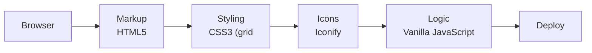

<h1 align="center">Grand Prix — Motorcycle Store</h1>

<p align="center"><b>A motorcycle shop landing page with a nine-item product grid and bold editorial styling.</b></p>

<p align="center">
<a href="https://mister2314.github.io/Motorcycle-Website/"></a>


</p>

<p align="center"><a href="https://mister2314.github.io/Motorcycle-Website/"><b>Live demo</b></a> &nbsp;·&nbsp; <a href="#quick-start">Quick start</a> &nbsp;·&nbsp; <a href="#features">Features</a> &nbsp;·&nbsp; <a href="#architecture">Architecture</a> &nbsp;·&nbsp; <a href="#faq">FAQ</a></p>

<p align="center">
  <a href="https://mister2314.github.io/Motorcycle-Website/">
    
  </a>
</p>

<p align="center"><sub>Live capture of the real build — 2208 KB, loops forever.</sub></p>

## Overview

A storefront landing page for a motorcycle brand. The centrepiece is a nine-tile product grid, supported by a title area, brand imagery and a footer built from the same visual language.

Typography does most of the work here — condensed display faces against a dark palette — and the layout is CSS grid from top to bottom.

## At a glance

| Field | Detail |
| --- | --- |
| **Type** | Static site — no build step |
| **Primary language** | CSS |
| **Live demo** | [mister2314.github.io/Motorcycle-Website](https://mister2314.github.io/Motorcycle-Website/) |
| **Repository** | [Mister2314/Motorcycle-Website](https://github.com/Mister2314/Motorcycle-Website) |

## Features

- Nine-tile product grid with hover states
- Condensed display typography (Rajdhani, Ubuntu, Heebo)
- Dark palette with high-contrast accents
- Icon set via Iconify and Font Awesome
- Multi-size favicon and Apple touch icons
- Responsive grid that reflows to a single column on mobile

## Tech Stack

| Layer | Technology |
| --- | --- |
| Markup | HTML5 |
| Styling | CSS3 (grid, custom properties) |
| Icons | Iconify, Font Awesome 6 |
| Logic | Vanilla JavaScript |
| Deploy | GitHub Pages |

## Architecture



## Screenshots

| Desktop | Mobile |
| :---: | :---: |
|  |  |

## Quick Start

```bash
git clone https://github.com/Mister2314/Motorcycle-Website.git
cd Motorcycle-Website

# open it directly
start index.html      # Windows
open  index.html      # macOS

# or serve the folder
npx serve .
```

## Project Structure

```
index.html — page markup
assets/css/style.css — grid, typography and hover states
assets/js/index.js — page behaviour
assets/img/ — product and brand imagery
```

## FAQ

<details>
<summary><b>What was the hardest part?</b></summary>

Keeping a nine-tile product grid even at every breakpoint. A grid that looks right at 1440 px usually collapses badly at 768 px, so the tile ratio is set rather than the column width.

</details>

<details>
<summary><b>Why three typefaces?</b></summary>

One condensed display face, one for body copy and one for numerals. That is the ceiling — a fourth would start to read as noise.

</details>

<details>
<summary><b>Is the grid dynamic?</b></summary>

No. The tiles are static markup. A real store would drive them from data, which is what the Pawsoome project does.

</details>

## Roadmap

- [ ] Move the tiles to a data array and render them
- [ ] Add real product pages
- [ ] Compress the product imagery

## Author

**Xəyal Hüseynli** — Junior Front-End Developer

[Portfolio](https://hypnosdev.vercel.app) · [GitHub](https://github.com/Mister2314) · [LinkedIn](https://www.linkedin.com/in/x%C9%99yal-h%C3%BCseynli-3487b91ba/) · [xeyalhuseynli06@gmail.com](mailto:xeyalhuseynli06@gmail.com)
