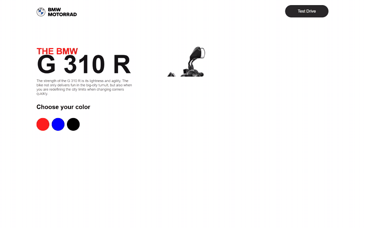

# Motorcycle-Website

"Grand Prix" — a motorcycle store landing page rebuilt as an industrial catalogue: nine spec'd tiles, fluid display typography and a red machine-stamp accent on a white field.

**Live demo:** <https://motorcycle-website-morpheus2314s-projects.vercel.app/>

<div align="center">



| Desktop | Mobile |
|---|---|
|  |  |

<details>
<summary>More screenshots</summary>

| Desktop | Mobile |
|---|---|
|  |  |

</details>

</div>

## What it does

A motorcycle showroom page: hero, a nine-tile catalogue gallery with a lightbox, a showroom configurator with a live build sheet and spec comparison, a validated test-ride booking form, and a footer — all sharing one visual language. The design treats every element like a catalogue entry: index plates, ruled frames, letterspaced metadata and a red machine-stamp accent. Typography carries it: Rajdhani condensed caps for display, Heebo for letterspaced meta, Ubuntu for body — all on a fluid `clamp()` scale.

The grid is CSS Grid top to bottom and reflows to a single full-bleed column on mobile. Scroll reveals are once-only with a 70 ms row rhythm, driven by one IntersectionObserver. No animation library — every transition is CSS on `transform`/`opacity`.

## Tech stack

React 19 · TypeScript · Vite · zero runtime animation dependencies

## Features

- Nine-tile catalogue grid: index plates, ruled frames, spec strips on hover
- **Lightbox gallery** — native `<dialog>` with focus containment, Arrow-key navigation, Escape close and focus return to the triggering tile
- **Showroom configurator** — three colourways (CSS-filter duotone) + accessory checkboxes feeding a live build sheet with running total
- **Spec comparison** — three models, ten rows, side-by-side table with the selected model highlighted; horizontally scrollable on mobile
- **Book-a-ride form** — client-side validation with `aria-invalid`, `role="alert"` messages, focus-to-first-error, past-date and closed-Sunday rules
- Dark/light theme: system default, persisted toggle, inline first-paint script (no flash), `color-scheme` set — dark is designed, not inverted
- Scroll progress rule in the header; sticky header that condenses past 100 px
- Once-only scroll reveals with per-row 70 ms stagger (IntersectionObserver)
- Tile choreography — image zoom (1.06), red duotone stamp (`mix-blend-mode: multiply`), press feedback (0.98 scale)
- Fluid typographic scale via `clamp()`; mobile nav as a scrollable anchor strip with ≥44 px targets
- Reduced-motion honored: reveals render instantly, hover zoom falls back to opacity-only cues
- Lazy-loaded grid images (`loading="lazy"`, `decoding="async"`)

### 360° viewer — static fallback

A canvas-based 360° turntable was evaluated but deliberately **not** shipped: it needs 24–36 photographic frames per bike, which this free static project cannot produce honestly. The configurator's colourway preview is the static fallback — a single frame per colour, no fake pseudo-3D. If a frame set is ever captured, a canvas turntable can slot into the configurator without touching the rest of the page.

## Run locally

```bash
git clone https://github.com/Mister2314/Motorcycle-Website.git
cd Motorcycle-Website
npm install
npm run dev
```

## Notes

- Tiles render from a data array in `src/App.tsx`; tile images map to alt text in `src/components/BoxSection.tsx`.
- `git tag pre-revamp-motorcycle` holds the pre-revamp design for comparison.
