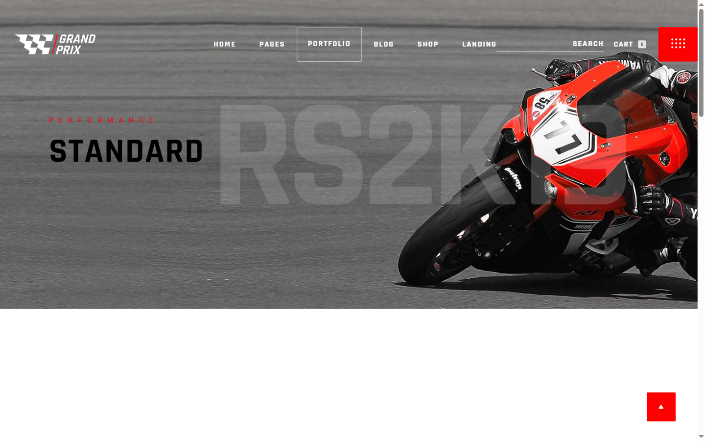
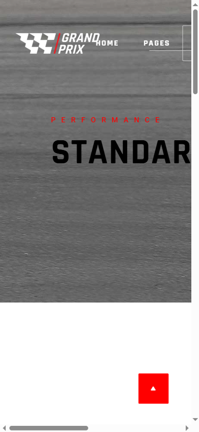

# Motorcycle-Website

"Grand Prix" — a motorcycle store landing page with a nine-item product grid and dark editorial styling.

**Live demo:** <https://mister2314.github.io/Motorcycle-Website/>

<p align="center">
<div align="center">

| Desktop | Mobile |
|---|---|
|  |  |

</div>
</p>

## What it does

A storefront landing page: hero title area, a nine-tile product grid, brand imagery and a footer sharing one visual language. Typography carries the design — condensed display faces (Rajdhani, Ubuntu, Heebo) against a dark palette. The grid is CSS Grid top to bottom and reflows to a single column on mobile. A small vanilla-JS script handles the scroll-to-top button.

## Tech stack

HTML5 · CSS3 (Grid, custom properties) · Vanilla JS · Iconify, Font Awesome 6

## Features

- Nine-tile product grid with hover states, fixed tile ratio across breakpoints
- Condensed display typography: three typefaces with distinct roles
- Grid reflows to one column on mobile
- Scroll-to-top button that appears past 100 px of scroll
- Multi-size favicon and Apple touch icons

## Run locally

```bash
git clone https://github.com/Mister2314/Motorcycle-Website.git
cd Motorcycle-Website
npx serve .   # or just open index.html
```

Limitation: the tiles are static markup — a real store would render them from a data array.
